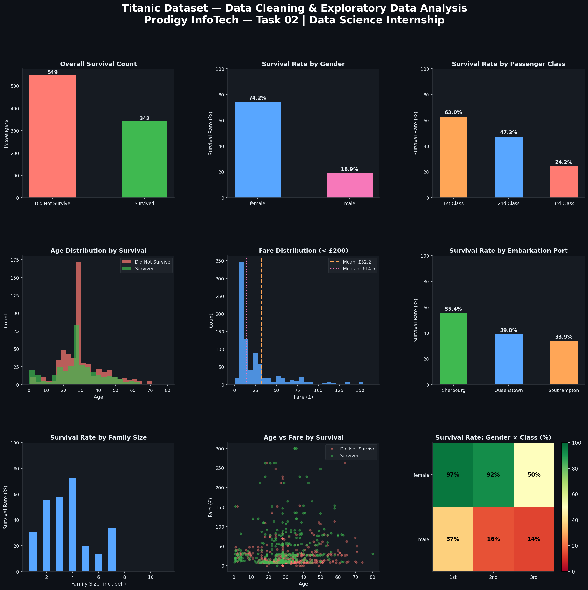

# Titanic: Data Cleaning & Exploratory Analysis

Task 02 of my Data Science internship at **Prodigy InfoTech** (May – Jun 2026).

Cleaning and exploring the classic Titanic passenger dataset (891 passengers) to find out which factors drove survival.



## What the script does

**Cleaning**
- Reports missing values per column
- Fills missing `Age` with the median and missing `Embarked` with the most common port
- Drops `Cabin` (mostly empty)

**Feature engineering**
- `FamilySize = SibSp + Parch + 1`

**Analysis**: a 9-panel visual report
1. Overall survival count
2. Survival rate by gender
3. Survival rate by passenger class
4. Age distribution by survival
5. Fare distribution with mean and median
6. Survival rate by embarkation port
7. Survival rate by family size
8. Age vs. fare, colored by survival
9. Survival heatmap: gender × class

## Key findings

- Only about **38%** of passengers survived.
- **Gender** was the strongest factor: roughly 74% of women survived vs. 19% of men.
- **Class** mattered too: about 63% survival in 1st class vs. 24% in 3rd.
- Small families (2–4 people) survived more often than people travelling alone or in very large families.

## Run it

```bash
pip install pandas numpy matplotlib
python PRODIGY_DS_02.py
```

The script reads `titanic.csv` from this folder if it is there, and otherwise downloads it from [datasciencedojo/datasets](https://github.com/datasciencedojo/datasets).

**Stack:** Python, pandas, NumPy, Matplotlib
